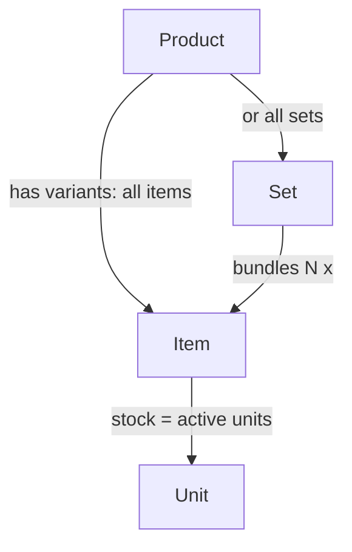
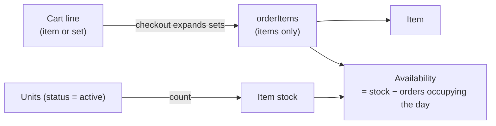
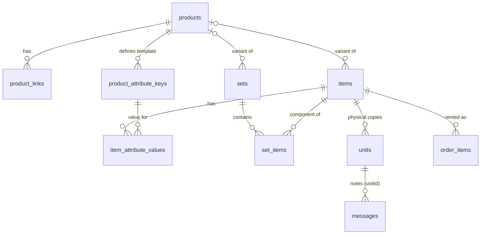

# Stock model

How the shop's stock is modelled, as of `main` @ `b3ff951`. There are four **stock types**:

- **Product**: what the shop shows. A title, description and category, e.g. "Edelrid Harness". It is never rented itself.
- **Item**: one variant of a product, e.g. "Edelrid Harness, Green, M". Items are what orders rent.
- **Set**: a variant of a product that is a bundle of items, e.g. "Indoor Climbing Set, M" = 1 harness M + 1 chalk bag + 1 belay device. When an order is placed, the set is replaced by its items.
- **Unit**: one physical object of an item, e.g. harness #3 with its own serial number. Only admins see units. An item's stock is its number of active units.

See `docs/schema.md` for the design rationale behind the schema.

## Summary







## Schemas

All tables live in `src/db/schema.ts`. Code blocks below are trimmed (comments removed).

### Product

Made of:

- `products`: title, description, category/sub-category, `hidden`/`published` status, thumbnail.
- `productLinks`: external links (manufacturer page, manual).
- `productAttributeKeys`: the attribute **template** (field names like "Size", "Weight"). Values live on items, not here.

A product's variants are either all items or all sets, never a mix. This is enforced in `setItemsProduct` and `setSetsProduct`, not in the DB.

```ts
export const products = sqliteTable('products', {
  id: integer('id').primaryKey({ autoIncrement: true }),
  slug: text('slug').notNull().unique(),
  title: text('title').notNull(),
  description: text('description'),
  categoryId: integer('category_id').references(() => categories.id),
  subcategoryId: integer('subcategory_id').references(() => subcategories.id),
  status: text('status', { enum: ['hidden', 'published'] }).notNull().default('hidden'),
  thumbnailImageUrl: text('thumbnail_image_url'),
  createdAt: integer('created_at', { mode: 'timestamp' }).notNull().default(sql`(unixepoch())`),
  updatedAt: integer('updated_at', { mode: 'timestamp' }).notNull().default(sql`(unixepoch())`),
});

export const productLinks = sqliteTable('product_links', {
  id: integer('id').primaryKey({ autoIncrement: true }),
  productId: integer('product_id').notNull().references(() => products.id, { onDelete: 'cascade' }),
  label: text('label').notNull(),
  url: text('url').notNull(),
});

export const productAttributeKeys = sqliteTable('product_attribute_keys', {
  id: integer('id').primaryKey({ autoIncrement: true }),
  productId: integer('product_id').notNull().references(() => products.id, { onDelete: 'cascade' }),
  name: text('name').notNull(),
  sortOrder: integer('sort_order').notNull().default(0),
}, (table) => [
  uniqueIndex('product_attribute_keys_product_name_unique').on(table.productId, table.name),
]);
```

### Item

Made of:

- `items`: admin-only name, image, optional `productId`, `archived` soft-delete flag. There is no stock column.
- `itemAttributeValues`: one value per product attribute key (e.g. Size = "M").
- Stock comes from `units` (see [Unit](#unit)).

```ts
export const items = sqliteTable('items', {
  id: integer('id').primaryKey({ autoIncrement: true }),
  productId: integer('product_id').references(() => products.id, { onDelete: 'set null' }),
  slug: text('slug').notNull().unique(),
  name: text('name').notNull(), // admin-only label
  imageUrl: text('image_url'),
  archived: integer('archived', { mode: 'boolean' }).notNull().default(false),
  createdAt: integer('created_at', { mode: 'timestamp' }).notNull().default(sql`(unixepoch())`),
});

export const itemAttributeValues = sqliteTable('item_attribute_values', {
  id: integer('id').primaryKey({ autoIncrement: true }),
  itemId: integer('item_id').notNull().references(() => items.id, { onDelete: 'cascade' }),
  attributeId: integer('attribute_id').notNull().references(() => productAttributeKeys.id, { onDelete: 'cascade' }),
  value: text('value').notNull().default(''),
}, (table) => [
  uniqueIndex('item_attribute_values_item_attribute_unique').on(table.itemId, table.attributeId),
]);
```

### Set

Made of:

- `sets`: has the same fields as `items` plus `label`, a short text the admin types to tell sibling sets apart (e.g. "S"/"M"/"L"). It has no attribute values and no stock of its own.
- `setItems`: the items in the set and how many of each.

How many of a set are available depends on its scarcest component.

```ts
export const sets = sqliteTable('sets', {
  id: integer('id').primaryKey({ autoIncrement: true }),
  productId: integer('product_id').references(() => products.id, { onDelete: 'set null' }),
  slug: text('slug').notNull().unique(),
  name: text('name').notNull(), // admin-only label
  label: text('label'),         // customer-facing variant label
  imageUrl: text('image_url'),
  archived: integer('archived', { mode: 'boolean' }).notNull().default(false),
  createdAt: integer('created_at', { mode: 'timestamp' }).notNull().default(sql`(unixepoch())`),
});

export const setItems = sqliteTable('set_items', {
  id: integer('id').primaryKey({ autoIncrement: true }),
  setId: integer('set_id').notNull().references(() => sets.id, { onDelete: 'cascade' }),
  itemId: integer('item_id').notNull().references(() => items.id),
  quantity: integer('quantity').notNull().default(1),
}, (table) => [
  uniqueIndex('set_items_set_item_unique').on(table.setId, table.itemId),
  check('set_items_quantity_positive', sql`${table.quantity} > 0`),
]);
```

### Unit

Made of:

- `units`: one physical object of an item. It holds brand, model, marking, serial number, dates, `status` and free-form `opts`. Units are never hard-deleted.
- `messages` (rows with `unitId` set): the unit's lifetime log, such as inspections, damage and status changes.

Item stock = `count(units where status = 'active')`.

```ts
export const UNIT_STATUSES = ['active', 'out_of_service', 'retired'] as const;

export const units = sqliteTable('units', {
  id: integer('id').primaryKey({ autoIncrement: true }),
  itemId: integer('item_id').notNull().references(() => items.id),
  brand: text('brand'),
  model: text('model'),
  marking: text('marking'),
  serialNumber: text('serial_number'),
  manufacturedAt: text('manufactured_at'), // YYYY-MM-DD
  purchasedAt: text('purchased_at'),       // YYYY-MM-DD
  status: text('status', { enum: UNIT_STATUSES }).notNull().default('active'),
  opts: text('opts', { mode: 'json' }).$type<Record<string, string>>().notNull().default(sql`'{}'`),
  createdAt: integer('created_at', { mode: 'timestamp' }).notNull().default(sql`(unixepoch())`),
}, (table) => [
  index('units_item_id_status_idx').on(table.itemId, table.status),
  check('units_status_valid', sql`${table.status} IN ('active', 'out_of_service', 'retired')`),
]);

// in `messages`:
unitId: integer('unit_id').references(() => units.id), // null = hub-board message
```

## Callers

Only files in `src/lib/` touch the stock tables. Pages, API routes and components go through these files.

### Files and functions

| File | Stock types | Functions | Used by |
|---|---|---|---|
| `src/lib/products.ts` | Product, Item | `createProduct`, `updateProduct`, `getProductForEdit`, `listProductsForAdmin` | `/admin/products/*`, `/api/products/*` |
| `src/lib/wizard.ts` | Item, Product, Unit | `getWizardItems`, `listProductOptions`, `createItem`, `archiveItems`, `setItemsImage`, `setItemsProduct`, `setItemAttributeValue`, `setBulkAttributeValues` | `/admin/items`, `/api/wizard/*` |
| `src/lib/units.ts` | Unit, Item | `activeUnitCount`, `itemStockExtras`, `getUnitsPageItem`, `listUnitsForItem`, `listAllUnits`, `getUnit`, `createUnits`, `updateUnit`, `setUnitStatus` | `/admin/units`, `/admin/items/[id]/units`, `/api/wizard/units` |
| `src/lib/setWizard.ts` | Set, Item | `getWizardSets`, `listComponentItemOptions`, `createSet`, `archiveSets`, `setSetsImage`, `setSetsProduct`, `setSetLabel`, `addSetComponent`, `updateSetComponentQuantity`, `removeSetComponent` | `/admin/sets`, `/api/wizard/set*` |
| `src/lib/sets.ts` | Set, Item, Product | `getSetChildrenBulk`, `getSetChildrenDetailedBulk`, `getValidSetIds`, `resolveEntriesToItemQuantities`, `setsThatFit`, `computeSetAvailability`, `getSetComponentDisplayBulk` | cart, orders, shop, reservation, set wizard |
| `src/lib/shop.ts` | Product, Item, Set | `getShopItems`, `getShopSets`, `getShopGridProducts`, `getShopProductBySlug` | `/`, `/products/[slug]` |
| `src/lib/cart.ts` | Item, Set, Product | `getCartLines` (via `buildItemLines`, `buildSetLines`) | cart sidebar, `/reservation`, `/api/cart/*` |
| `src/lib/availability.ts` | Item (+ Unit count) | `getStockCounts`, `getDailyAvailability`, `getAvailableForRange`, `getOccupiedToday`, `getOverbookedOrders`, `setDailyAvailability`, `getHandedOut`, `getRealAvailability` | shop, cart, reservation, orders, admin |
| `src/lib/availabilityCalendar.ts` | Item, Set | `getProductVariantCalendars` | `/products/[slug]`, `/admin/items` |
| `src/lib/reservation.ts` | Item | `getReservationAvailability`, `getCartLineAvailability` | `/api/reservation/availability`, `/api/orders/create` |
| `src/lib/orders.ts` | Item, Set | `createOrder`, `rescheduleOrder` | `/api/orders/*` |
| `src/lib/moderatorOrders.ts` | Item, Product | `getPendingRequestRows`, `getOrderDetail`, `getFollowingRentalWorries` | `/moderator/*`, `/api/moderator/*` |

### What the functions do and use

**Product** (`products.ts`)

| Function | Does | Uses |
|---|---|---|
| `createProduct` | Inserts a product with its links and attribute keys | `products.*`, `productLinks`, `productAttributeKeys` |
| `updateProduct` | Updates fields, replaces links, adds new attribute keys and gives existing items a blank value for each new key | `products.*`, `productLinks`, `productAttributeKeys`, `items.productId`, `itemAttributeValues` |
| `getProductForEdit` | Loads one product for the edit form | `products.*`, `productLinks`, `productAttributeKeys` |
| `listProductsForAdmin` | Lists products with category names | `products.title/status`, categories |

**Item** (`wizard.ts`)

| Function | Does | Uses |
|---|---|---|
| `getWizardItems` | Lists non-archived items, split into unassigned and assigned, with stock and attributes | `items.*`, `products.title/description`, `productAttributeKeys`, `itemAttributeValues`, unit stock, `getRealAvailability` |
| `createItem` | Inserts an item with N blank units | `items`, `units.itemId` |
| `archiveItems` / `setItemsImage` | Bulk soft-delete or image update | `items.archived`, `items.imageUrl` |
| `setItemsProduct` | Assigns items to a product. Items that change product get their attribute values wiped and replaced with blanks for the new product's keys. Fails if the product already has sets | `items.productId`, `sets.productId/archived`, `itemAttributeValues`, `productAttributeKeys` |
| `setItemAttributeValue` / `setBulkAttributeValues` | Sets one key's value on one or many items. Creates the key on the product if it's missing and gives every item on the product a blank value for it | `items.productId`, `productAttributeKeys`, `itemAttributeValues` |

**Set** (`setWizard.ts`, `sets.ts`)

| Function | Does | Uses |
|---|---|---|
| `getWizardSets` | Lists non-archived sets with components, stock and an "includes" summary | `sets.*`, `setItems`, `items.name/imageUrl/archived`, unit stock, `products.title`, `getHandedOut` |
| `listComponentItemOptions` | Items the set component picker offers | `items.name/archived`, `products.title` |
| `createSet` / `archiveSets` / `setSetsImage` / `setSetLabel` | Basic set writes | `sets.*` |
| `setSetsProduct` | Assigns sets to a product. Fails if the product already has items | `sets.productId`, `items.productId/archived` |
| `addSetComponent` / `updateSetComponentQuantity` / `removeSetComponent` | Edits which items are in a set and how many of each | `setItems.*`, `items.archived` |
| `getSetChildrenBulk` | Lists the `(itemId, quantity)` pairs of each set | `setItems` |
| `getSetChildrenDetailedBulk` | Same, plus display info and stock for each component | `setItems`, `items.imageUrl/archived/name`, `products.title`, unit stock |
| `getValidSetIds` | Returns the sets that can be ordered: not archived, with at least one component and no archived components | `sets.archived`, `setItems`, `items.archived` |
| `resolveEntriesToItemQuantities` | Expands set entries into item quantities and adds up quantities for the same item | `setItems` |
| `setsThatFit` / `computeSetAvailability` | How many whole sets fit, decided by the scarcest component | component stock + reservations |
| `getSetComponentDisplayBulk` | Builds a set's "includes" display from its components' attribute values | `setItems`, `items.name`, `products.title`, `productAttributeKeys`, `itemAttributeValues` |

**Unit** (`units.ts`)

| Function | Does | Uses |
|---|---|---|
| `activeUnitCount` / `itemStockExtras` | SQL subquery: an item's stock = active units. Used everywhere stock is read | `units.itemId/status` |
| `getUnitsPageItem` | Loads the item that a units page is about | `items.name/imageUrl/archived`, `products.title` |
| `listUnitsForItem` / `listAllUnits` / `getUnit` | Reads units | `units.*`, `items.name/archived` |
| `createUnits` / `updateUnit` | Adds units in a batch or edits a unit's fields | `units.*` |
| `setUnitStatus` | Changes a unit's status and logs a note, which changes item stock right away | `units.status`, `messages.unitId` |

**Shop, cart and availability** (`shop.ts`, `cart.ts`, `availability.ts`, `availabilityCalendar.ts`, `reservation.ts`)

| Function | Does | Uses |
|---|---|---|
| `getShopItems` / `getShopSets` | Lists non-archived variants of published products with today's availability | `items`/`sets`, `products.status/title/slug`, categories, `itemAttributeValues`, set components, unit stock |
| `getShopGridProducts` | Turns the variants into one tile per product (item products first) | output of the two above |
| `getShopProductBySlug` | Product page: product, links, attribute key order, item and set variants | `products.*`, `productLinks`, `productAttributeKeys`, `items`, `itemAttributeValues`, `sets`, `setItems` |
| `getCartLines` | Builds displayable cart lines from the cart cookie. Drops archived or unpublished entries | `items`/`sets`, `products.status/title/slug/thumbnail`, `itemAttributeValues`, set components, unit stock |
| `getStockCounts` | Stock per item | `items.id`, `units` (via `activeUnitCount`) |
| `getDailyAvailability` / `getAvailableForRange` / `getOccupiedToday` | Stock minus quantities held by orders, per day | item stock, `orderItems.itemId` + orders |
| `getOverbookedOrders` | Orders on days where stock < bookings, e.g. after a unit is taken out of service | item stock, orders |
| `getHandedOut` / `getRealAvailability` | What is physically on the shelf now | item stock, active orders |
| `setDailyAvailability` | Per-day count of whole sets that fit | component per-day availability |
| `getProductVariantCalendars` | 28-day calendar for each variant of a product | `items.productId/archived`, `sets.productId/archived`, `setItems`, item stock |
| `getReservationAvailability` / `getCartLineAvailability` | Checks whether requested items (or each set's components) are free across a date range | item stock, claims |

**Orders** (`orders.ts`, `moderatorOrders.ts`)

| Function | Does | Uses |
|---|---|---|
| `createOrder` | Drops invalid entries, expands sets into items, re-checks availability, inserts `orderItems` (items only) | `items.archived`, `getValidSetIds`, `resolveEntriesToItemQuantities`, item stock |
| `rescheduleOrder` | Re-checks the order's items for the new dates | `orderItems.itemId`, item stock |
| `getPendingRequestRows` | Moderator request queue: each order's item names and quantities | `orderItems`, `items.name` |
| `getOrderDetail` | Moderator view of one order. Flags items that are archived or unpublished and items that are double-booked | `items.name/imageUrl/archived`, `products.status`, item stock |
| `getFollowingRentalWorries` | Warns if a late return would break a later order for the same item | `orderItems.itemId`, `items.name`, item stock |
